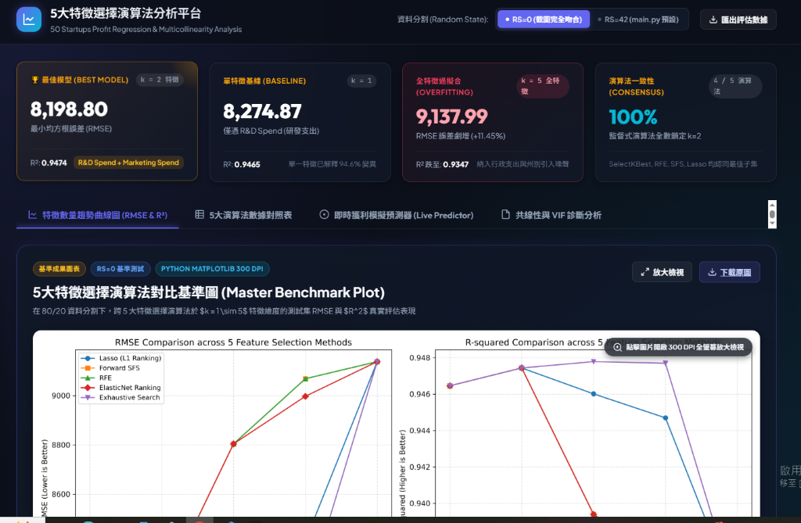
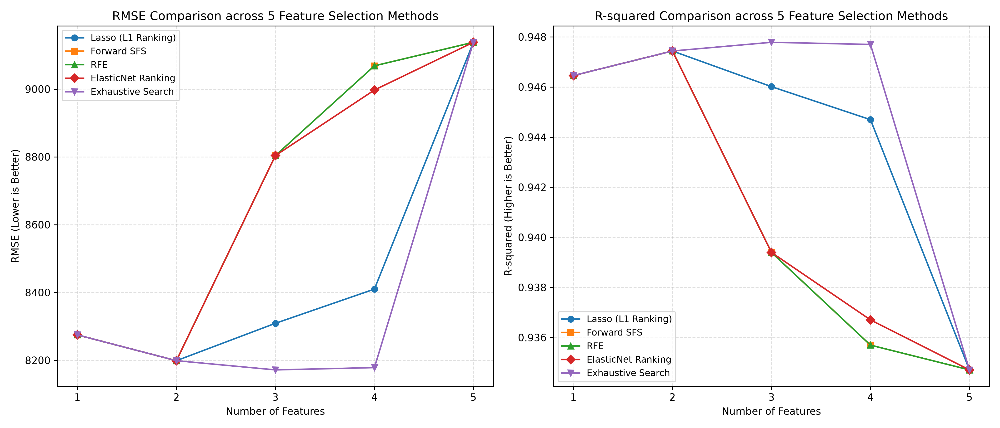

# AIOT-1014-DIC: 50 Startups 多元線性迴歸與特徵選擇比較分析

## 🔗 相關連結與展示

* **GitHub 連結**：https://github.com/czk001167-hash/AIOT-1014-DIC
* **網頁連結**：https://czk001167-hash.github.io/AIOT-1014-DIC/

### 📊 平台畫面截圖



---

本專案遵循 **CRISP-DM（Cross-Industry Standard Process for Data Mining）** 流程，針對新創公司數據集（`50_Startups.csv`）進行深度探索、特徵工程、多重共線性診斷，並系統性評估 **5 大特徵選擇演算法（Feature Selection Algorithms）** 在特徵維度 $k = 1 \sim 5$ 下對多元線性迴歸模型預測利潤（`Profit`）的影響與泛化能力。

專案同時包含以原生 Web 技術建構之**現代化互動式決策與預測儀表板**（Glassmorphism UI），提供即時利潤預估、特徵重要性分析與跨演算法比較。

---

## 📊 核心成果：特徵選擇演算法全維度對比

下圖為在測試集（Test Set, 80/20 分割, `random_state=0`）上評估 5 種特徵選擇演算法於 $k=1 \sim 5$ 時的表現：



### 關鍵統計學洞察：為什麼特徵不是越多越好？

1. **過擬合（Overfitting）與雜訊變數（Noise Variables）**：
   * 在 $k=1$ 時，單靠 `R&D Spend`（研發支出）即能解釋高達 **94.65%** 的利潤變異（Test RMSE = 8,275）。
   * 在 $k=2$ 時，加入 `Marketing Spend`（行銷支出）達到實務最佳泛化性能（Test RMSE 降至 **8,198.80**，Test $R^2$ 提升至 **0.9474**）。
   * 當特徵數繼續增加到 $k=3 \sim 5$（納入 `Administration` 行政支出與州別虛擬變數），**模型性能反而大幅劣化**（全變數時 RMSE 飆升至 **9,137.99**，降幅顯著）。這是因為後續特徵本質上接近雜訊，小樣本（50 筆）下多估計參數只會膨脹估計方差。

2. **演算法在端點的必然收斂**：
   * **$k=1$ 與 $k=2$ 完全重疊**：所有演算法的第一優先特徵均為 `R&D Spend`，前二特徵均為 `[R&D, Marketing]`。
   * **$k=5$ 完全合流**：候選特徵僅有 5 個，選滿時皆退化為傳統普通最小平方法（Full OLS）。

3. **貪婪搜尋陷阱（Greedy Trap）vs. 窮舉全域最優（Exhaustive Search）**：
   * **Forward SFS** 與 **RFE** 在 $k=3$ 時因前兩步鎖定 `[R&D, Marketing]`，只能被動加入 `Administration`，導致 RMSE 暴增至 8,804。
   * **Exhaustive Search（窮舉法）** 跳脫了前兩步的巢狀限制，在 $k=3$ 時跳過 Marketing，直接選取 `['R&D Spend', 'Administration', 'State_Florida']`，創下測試集最佳紀錄（RMSE = **8,171.65**，$R^2$ = **0.9478**）。

4. **Lasso L1 正則化的穩健折衷**：
   * **Lasso (L1 Ranking)** 透過稀疏係數收縮，在 $k=3$ 與 $k=4$ 優先將州別虛擬變數排在行政支出之前，表現明顯優於一般貪婪法。

---

## 🔍 5 大特徵選擇方法詳細規格

| 演算法 | 類型 | 核心機制 | 優點 | 局限性 |
| :--- | :--- | :--- | :--- | :--- |
| **Lasso (L1 Ranking)** | 嵌入法 (Embedded) | $L_1$ 正則化懲罰稀疏收縮 | 自動特徵剔除，抗共線性能力強 | 高度相關變數容易隨機保留其一 |
| **Forward SFS** | 封裝法 (Wrapper) | 基於 5-Fold CV $R^2$ 前向貪婪逐步加入 | 考慮特徵與模型的非線性交互作用 | 計算成本高，容易陷入局部最佳解 |
| **RFE** | 封裝法 (Wrapper) | 標準化 OLS 係數遞迴消除最小貢獻項 | 針對特定模型做全域剪枝 | 同樣受貪婪消除限制 |
| **ElasticNet Ranking** | 嵌入法 (Embedded) | $L_1 + L_2$ 混合正則化 | 群組效應（Group Effect），兼顧相關特徵 | 超參數需雙重調優（$\alpha, \text{l1\_ratio}$） |
| **Exhaustive Search** | 最佳子集 (Best Subset) | 評估 $\binom{5}{k}$ 所有組合在驗證上的表現 | 保證找到該維度下的全域最佳組合 | 當特徵數龐大時組合爆炸（維度災難） |

---

## 📈 評估指標對照表（$k=1 \sim 5$）

以 `random_state=0` 進行 80/20 切分後於測試集（$N=10$）之實測結果：

| 演算法 | $k$ | 所選特徵集合 | Test RMSE | Test $R^2$ | Test MAE |
| :--- | :---: | :--- | :---: | :---: | :---: |
| **Exhaustive Search** | **3** | `['R&D Spend', 'Administration', 'State_Florida']` | **8,171.65** | **0.9478** | **6,730.79** |
| **Exhaustive Search** | 4 | `['R&D', 'Administration', 'State_Florida', 'State_New York']` | 8,178.37 | 0.9477 | 6,751.89 |
| **實務首選 (All Methods)** | **2** | `['R&D Spend', 'Marketing Spend']` | **8,198.80** | **0.9474** | **6,886.59** |
| 基線單變數 (All Methods) | 1 | `['R&D Spend']` | 8,274.87 | 0.9465 | 6,772.45 |
| **Lasso (L1 Ranking)** | 3 | `['R&D Spend', 'Marketing Spend', 'State_New York']` | 8,309.06 | 0.9460 | 7,028.44 |
| **Lasso (L1 Ranking)** | 4 | `['R&D', 'Marketing', 'State_New York', 'State_Florida']` | 8,409.92 | 0.9447 | 7,109.16 |
| **Forward SFS / RFE / ENet** | 3 | `['R&D Spend', 'Administration', 'Marketing Spend']` | 8,803.78 | 0.9394 | 7,320.44 |
| **ElasticNet Ranking** | 4 | `['R&D', 'Marketing', 'Admin', 'State_New York']` | 8,997.20 | 0.9367 | 7,474.74 |
| **Forward SFS / RFE** | 4 | `['R&D', 'Admin', 'Marketing', 'State_Florida']` | 9,068.54 | 0.9357 | 7,431.47 |
| **全特徵基準 (Full OLS)** | 5 | 全部 5 項特徵 | 9,137.99 | 0.9347 | 7,514.29 |

---

## 🗂️ 專案檔案結構說明

```plaintext
AIOT-1014-DIC/
├── 50_Startups.csv                        # 50 筆新創公司原始資料集
├── main.py                                # 完整 CRISP-DM 流程主程式（包含 5 大特徵選擇與高清繪圖）
├── DIC.py                                 # 模型 B：聚焦多重共線性診斷與迭代 VIF 篩選分析
├── run_feature_selection_comparison.py    # 批次基準測試與比較矩陣生成腳本
├── generate_all_plots.py                  # 各演算法獨立 2-Panel 圖表生成器
├── dump_coefficients.py                   # 提取迴歸係數並匯出 JSON 供前端 Web 儀表板使用
├── feature_selection_comparison.png       # 5 大演算法特徵數 RMSE / R-squared 性能對比圖
├── startup_feature_selection_models.joblib # 序列化最佳模型與預處理管線
├── startup_model_comparison.csv           # 比較結果數據表
├── index.html                             # 現代化 Web 決策與實時利潤預測儀表板
├── app.js                                 # 儀表板交互邏輯與 Chart.js 數據視覺化
├── style.css                              # Glassmorphism 風格深色/質感 CSS 設計
├── screenshot.png                         # 5大特徵選擇演算法分析平台畫面截圖
├── requirements.txt                       # Python 相依套件清單
└── README.md                              # 專案詳細文檔
```

---

## 🌐 互動式 Web 預測儀表板

本專案提供基於瀏覽器的現代化分析介面（無需後端伺服器，直接以瀏覽器開啟 `index.html` 即可使用）：

* **即時利潤試算機**：輸入 R&D、行政、行銷支出與所在州別，即時計算模型預測利潤與信賴區間。
* **模型切換**：可自由在「單特徵模型」、「雙特徵最佳模型」、「3 特徵模型」與「全特徵模型」之間切換比對係數影響。
* **演算法雷達與折線圖**：內嵌 Chart.js 圖表，動態展現不同特徵維度下的 RMSE 與解釋力變化。

---

## 🚀 快速上手指南

### 1. 複製儲存庫
```bash
git clone https://github.com/czk001167-hash/AIOT-1014-DIC.git
cd AIOT-1014-DIC
```

### 2. 安裝 Python 相依套件
建議使用虛擬環境：
```bash
python -m venv venv
# Windows:
venv\Scripts\activate
# macOS/Linux:
source venv/bin/activate

pip install -r requirements.txt
```

### 3. 執行主分析腳本
```bash
python main.py
```
> 執行後將依序完成 EDA、特徵預處理、VIF 檢驗、5 大特徵選擇演算法訓練與評估，並彈出與儲存 `feature_selection_comparison.png` 高清成果圖。

### 4. 開啟 Web 儀表板
直接點擊雙擊 `index.html`，或使用 VS Code Live Server / Python 簡易伺服器：
```bash
python -m http.server 8080
```
在瀏覽器開啟 `http://localhost:8080` 即可體驗完整的互動式儀表板。

---

## 📌 結論與實務建議

1. **奧卡姆剃刀原則（Occam's Razor）**：
   在商業利潤預測中，**2 個特徵（`R&D Spend` + `Marketing Spend`）** 是性價比與泛化穩定性最高的選擇，既具備 94.74% 的強大解釋力，又避免了行政支出與地理虛擬變數帶來的雜訊過擬合。
2. **演算法選擇建議**：
   * 當候選特徵維度較小（如 $< 15$）時，優先採用 **Exhaustive Search（最佳子集法）**，能有效避免貪婪法的局部最優陷阱。
   * 當特徵維度龐大時，**Lasso (L1 Regularization)** 是兼顧計算效率與稀疏穩定性的首選。

---


